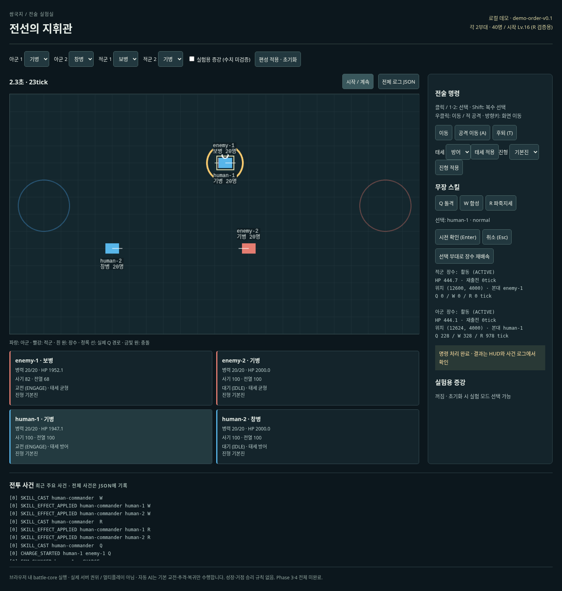
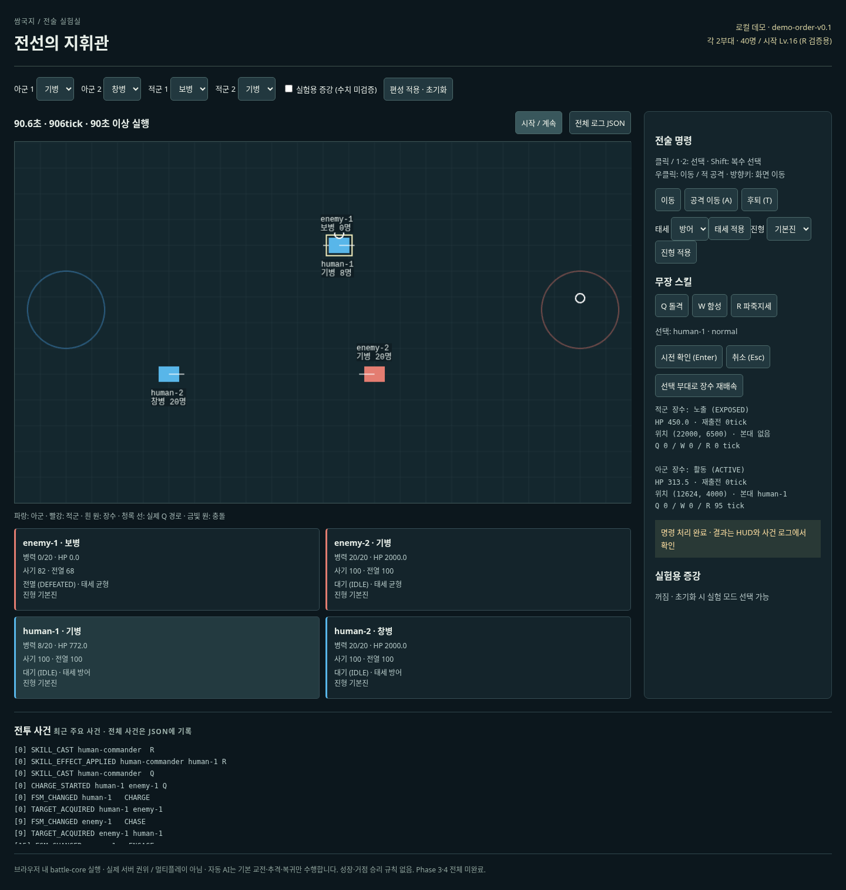

# demo-order-v0.1 검증 기록

## 2026-10-29 · Phase 4 로컬 데모 마무리 점검

이 절은 아래의 **첫 데모 브라우저 기록과 별도**입니다. 재생·명령 탐색 기능이 추가된 최신 상태에서 실행했습니다.

| 검사 | 결과 |
| --- | --- |
| `npm run typecheck` | 통과 |
| `npm test` | 17개 파일, 305개 테스트 통과. 명령 입력 직후 tick 인덱스와 체크포인트 역방향 탐색 포함 |
| `npm run sim:smoke` | Phase 2 및 장수 부분 1,000tick 상태·사건 해시 재현 일치 |
| `npm run build` | 통과 |
| `npm run format:check` | 통과 |
| `npm run test:browser` | 미실행. 이 작업 환경에 Chromium 실행 파일이 없고 Playwright 설치용 다운로드가 유효한 압축 파일을 반환하지 않음 |

최신 재생 화면, 명령 이동, 90초 UI와 headless 일치 여부는 실제 브라우저에서 검증해야 합니다. 이 절의 자동 검사 결과는 화면 검증이나 밸런스 평가를 대신하지 않습니다. 전투 규칙·설정값은 변경하지 않았습니다.

2026-10-26, Node.js 24.19.0 / 시스템 Chromium / Playwright 1.64.1.
이 기록은 첫 로컬 데모 검증이며 실제 플레이 밸런스 또는 Phase 4 전체 완료를 뜻하지 않습니다.

## 순차 검사

| 명령                                                      | 결과                                               |
| --------------------------------------------------------- | -------------------------------------------------- |
| npm run typecheck                                         | 코어·클라이언트 성공                               |
| npm run test                                              | 172개 통과: 기존 코어 159개 유지 + 클라이언트 13개 |
| npm run build                                             | 코어·Vite 클라이언트 성공                          |
| npm run sim:smoke                                         | 기존 두 1,000tick 시나리오 상태·이벤트 재현성 일치 |
| npm run format:check                                      | 성공                                               |
| DEMO_CHROMIUM_PATH=/usr/bin/chromium npm run test:browser | 최종 전체 재실행 3개 통과, 약 1.9분                |

코어 소스·기존 테스트·battle_config.v1.json은 변경하지 않았습니다.
빌드에는 Phaser를 포함한 약 1.36MB JS 청크 경고와 Zod 주석 annotation 경고가 있습니다. 빌드는 성공하며 번들 최적화는 후속입니다.

## 실제 브라우저에서 확인한 내용

- Phaser 캔버스와 한국어 HUD를 렌더링하고 실제 포인터/키보드/버튼 입력으로 조작했습니다.
- W/R 대상 선택과 확인, Q 적 지정과 확인, 실제 CHARGE_IMPACT, 쿨다운·HP·사기·전열 표시를 확인했습니다.
- 번호키 선택, 우클릭 이동·적 공격, 공격 이동·후퇴, 태세·진형 변경, 타인 선택 거부, 편성 적용·초기화, 잘못된 R 병종 거부를 확인했습니다.
- 실험용 증강 선택 뒤 가짜 후보 없이 후보 부족을 표시하는 것을 확인했습니다.
- 실제 브라우저 시계로 90초 이상(900tick 이상) 진행한 뒤 일시정지하고, 브라우저 최초 상태·명령 로그를 Node headless replay로 다시 실행했습니다. 최종 상태·이벤트 해시 모두 일치했습니다.
- 브라우저에 노출된 검증 API는 상태/로그 복사본만 반환하며 빠른 tick 진행이나 전투 상태 주입을 제공하지 않습니다.

브라우저 테스트 확장 중 다른 사례의 입력 시퀀스가 Q 사례에 잘못 들어간 테스트 오류를 수정했습니다. 위 결과는 수정 후 전체 브라우저 3개를 다시 실행한 결과입니다.
Playwright 관리 브라우저 다운로드는 이 환경에서 403으로 차단되어 이미 설치된 시스템 Chromium을 사용했습니다.

## 한계와 미검증

- 장수의 부상·재출전 로직은 기존 코어 회귀 테스트를 유지하고 HUD에 상태/위치/타이머를 연결했습니다. 브라우저 테스트는 부상을 강제로 주입하여 모든 경계를 별도로 반복하지 않습니다.
- Chromium 데스크톱 한 환경만 검증했습니다. 다른 브라우저·모바일·접근성·실제 사용자 조작감 평가는 미검증입니다.
- 코어의 점 모델·장애물 없는 평면·시야 미구현 한계가 그대로 적용됩니다. 렌더링 격자는 게임 맵 경계가 아닙니다.
- 운영용 증강 콘텐츠·9종 확장·네트워크·성장·거점 승리·아트 제작은 이번 범위에 없습니다.

## 실행 화면

실제 Q 충돌 직후:

90초 이상 실행 후:

